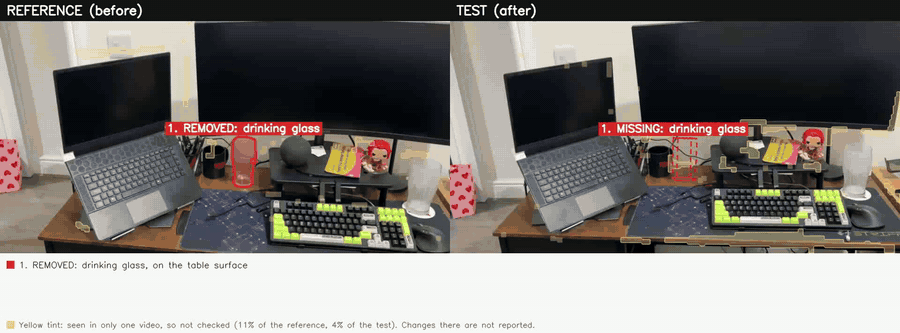
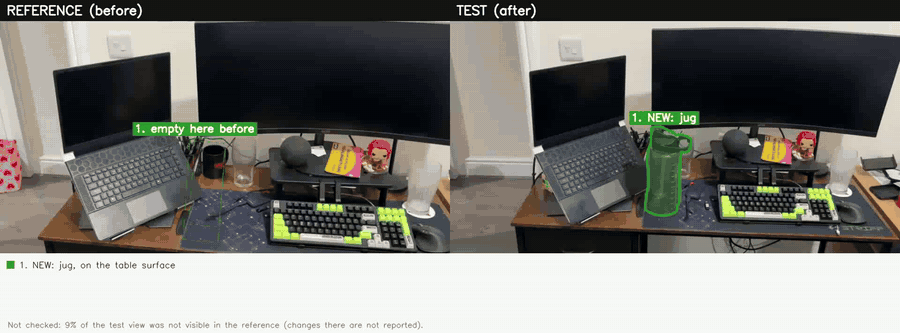

# What changed in the room?

Evidence-based 3D change detection from two phone videos of the same indoor space.



*Output for test7. Left: the reference video, with the drinking glass outlined next to the black mug. Right: the test video, where a dashed box marks the empty spot. A light yellow tint marks surfaces that only one video saw, which the system leaves unchecked. The change list runs underneath. The depth model sees through the glass, so the second (appearance) channel found it. Full video: [results/cool_white/test7/comparison.mp4](results/cool_white/test7/comparison.mp4).*

## Abstract

A robot that returns to a room has to tell which differences are real changes and which come from looking from a different place. This project compares two short phone videos of a desk and reports objects that were added, removed or moved, in 3D and in plain language. Both videos are reconstructed together with VGGT, so they share one coordinate frame from the start. A change is accepted only with positive evidence: one video must have seen empty space where the other sees an object. Areas seen by only one video are reported as unchecked rather than changed. Transparent objects, which the depth model sees through, are handled by a second channel that compares appearance across views and verifies each candidate against nearby control places. Segment Anything outlines each object and carves its 3D box. On eight recorded test pairs (one jug added, one glass removed, six with no change), all outputs matched the visually established ground truth, including five high-angle pairs, three of which produced false alarms before the verification step. The thresholds were tuned on these same pairs, and no recording contains a moved object.

## 1. Problem

Two reconstructions of an unchanged room still differ. The second video sees surfaces the first never saw, objects hide each other from some viewpoints, depth networks fail on glass and dark screens, and the two reconstructions never line up exactly. Comparing point clouds by distance reports all of these as changes. The challenge asks for the opposite: identify what changed and where, while separating real changes from viewpoint, occlusion and incomplete observation.

The approach here treats change detection as a question of evidence, following the reasoning of occupancy grids in robot mapping [6]: a camera ray that passes through a point is evidence that the point is empty. A point present in one video counts as changed only if the other video's cameras looked through it.

## 2. Data

Ten phone videos of one desk, 1024 × 576 pixels, 3 to 5 seconds each (85 to 129 frames): two references, under cool white light and under a warm lamp, and eight tests. Each test is compared with the reference recorded under the same light, chosen by the average red/blue colour ratio of the video (about 1.1 for cool white, 1.7 for warm). Ground truth comes from comparing matched views of each pair by eye; it is recorded in [data/scenes.yaml](data/scenes.yaml).

| Group | Reference | Tests |
|---|---|---|
| cool white | `ref1_light1.mp4` | test3, test4, test5, test6, test7, test8 |
| warm lamp | `ref2_light2.mp4` | test1, test9 |

## 3. Method

```
before.mp4 + after.mp4
 3.1 keyframes          40 sharp frames per video, kept in memory
 3.2 shared 3D scene    both videos through VGGT in one pass, metric scale, room frame
 3.3 evidence check     each voxel: changed / unchanged / unknown; alignment refined on unchanged geometry
 3.4 objects            depth and appearance candidates, verified, matched into moves, outlined, labelled
 3.5 output             comparison video, changes.json, report.md, top-down map, Rerun 3D recording
```

### 3.1 Keyframes

Each video is divided into 40 time slots and the sharpest frame of each slot (variance of the Laplacian) is kept. Frames stay in memory; nothing is written to disk. Code: [wcitr/frames.py](wcitr/frames.py).

### 3.2 Shared 3D scene

All 80 keyframes go through VGGT [1] in a single forward pass, which returns camera poses and depth maps for both videos in one coordinate frame. No separate registration step is needed, so a moved object cannot pull the alignment off. Depth Anything V2 (indoor, metric) [2] sets the scale in metres from the median ratio of its depth to VGGT's depth. A horizontal plane fitted to the lowest points (the desk or the floor) becomes z = 0, and the origin lies below the first camera of the reference video. Code: [wcitr/reconstruct.py](wcitr/reconstruct.py).

### 3.3 Evidence check

Every confident depth pixel of one video becomes a 3D point and is projected into the other video's cameras:

| The other camera saw | Vote |
|---|---|
| farther than the point | free: it looked through empty space |
| the same surface | consistent |
| something nearer | none (the point was hidden) |
| nothing (out of view) | none |

Votes are fused in 2 cm voxels. A voxel is changed when at least 75% of its votes are free, unchanged when at most 35% are, and unknown otherwise or with fewer than three votes. Before the cross-video check, each point must be confirmed by at least two other frames of its own video and must not be seen through by that video, which removes noise and people walking through.

Two details came from failures on real data. Pixels at depth edges are dropped only when their depth lies between the near and far surface; dropping the whole edge band shaved a strip off every silhouette. Edges are found from the second difference of inverse depth, which is zero on any plane, because depth differences flagged floors seen at a shallow angle as edges.

The two videos never align perfectly. A refinement step aligns them by ICP on unchanged voxels only, and the remaining error sets the tolerance of a second pass: 2.5 times the measured RMSE, clamped to 1 to 5 cm. Free space must then hold over a window that covers this tolerance at the point's depth. Code: [wcitr/changes.py](wcitr/changes.py), [wcitr/align.py](wcitr/align.py).

### 3.4 Objects

Changed voxels of each video are clustered (DBSCAN). Clusters stacked vertically with overlapping footprints are merged, because a clear jug's body is invisible to depth and its lid and base would otherwise be two objects. A removed and an added object that look alike (CLIP embedding, colour, size, label) form one moved event; ICP gives the displacement and the rotation, and a rotation is reported only when it fits clearly better than no rotation. Code: [wcitr/objects.py](wcitr/objects.py).

An appearance channel finds changes the depth map cannot see. For each frame, the most similar frames of the other video are warped into its view, and DINOv2 [3] patch features are compared; a pixel counts as changed only if no warped view agrees with it. The changed pixels of many frames are intersected in 3D (a visual hull [7]) to locate the object, because a transparent object's pixels carry the depth of the wall behind it. Code: [wcitr/appearance.py](wcitr/appearance.py).

Every candidate, from either channel, is then verified. Crops of the candidate from matched views (an after frame and the before frame with the closest camera pose) are compared with DINOv2. A real change must score below 0.72 and at least 0.10 below control places, which are the same region shifted sideways by one object width and seen through the same view pairs. The controls absorb the general drop in similarity when the two videos look from very different angles. For appearance-only candidates, CLIP [4] scores every object name on the before crops and the after crops; the name with the largest difference becomes the label, and its sign says whether the object was removed or added. Code: [wcitr/verify.py](wcitr/verify.py).

Segment Anything [5], prompted with the projected box, outlines each object in up to 12 keyframes. A point of the box is kept if it falls inside the outline in at least 75% of the views that see it. For an opaque object, space in front of its visible surface is removed. For a transparent object, detected when the depth behind its outline is clearly farther than the object, the object must stand in front of what is seen through it, and it is assumed to be about as deep as it is wide and to rest on a surface. Code: [wcitr/segment.py](wcitr/segment.py).

### 3.5 Output

Each object is named by CLIP from its crop (Claude can name it instead when an API key is set; that path has not been tested). Every sentence, box and arrow is generated from `changes.json`, so the text, the video, the top-down map and the 3D recording agree. Heights are measured from the surface found under each object. The video shows a short caption per change ("REMOVED: drinking glass, on the table surface"), since the outline already shows where it is; `changes.json` and `report.md` keep the full location and the coordinates in metres. Surfaces that only one video saw are tinted light yellow in that video's half, so the unchecked areas are visible in the footage itself. Code: [wcitr/semantics.py](wcitr/semantics.py), [wcitr/report.py](wcitr/report.py), [wcitr/video.py](wcitr/video.py).

## 4. Results

### 4.1 All test pairs

| Test | Light and viewpoint | Ground truth | Output | Match |
|---|---|---|---|---|
| test4 | cool white | clear plastic jug added | Jug was added on the table surface | yes |
| test7 | cool white | drinking glass removed | Drinking glass was removed. It was on the table surface | yes |
| test6 | cool white | no change (control) | no changes | yes |
| test3 | cool white, high angle | no change | no changes | yes |
| test5 | cool white, high angle | no change | no changes | yes |
| test8 | cool white, high angle | no change | no changes | yes |
| test1 | warm, very dark, high angle | no visible change | no changes | yes |
| test9 | warm, high angle | no visible change | no changes | yes |

The ground truth for test4 and test7 is clear in the footage. For the other six, I found no difference between matched views; for test1 that judgement is less certain because the video is very dark.

### 4.2 Alignment, tolerance and coverage

| Test | ICP correction found (mm) | Tolerance (cm) | Unchecked surfaces, before / after (%) |
|---|---|---|---|
| test4 | 2.6 | 1.5 | 7.4 / 9.2 |
| test6 | 5.0 | 1.2 | 11.7 / 5.5 |
| test7 | 6.0 | 1.1 | 11.3 / 3.8 |
| test3 | 47.9 | 4.0 | 41.4 / 12.9 |
| test5 | 37.7 | 3.8 | 59.4 / 11.4 |
| test8 | 39.9 | 3.8 | 32.3 / 12.9 |
| test1 | 61.2 | 4.0 | 43.1 / 10.3 |
| test9 | 42.8 | 3.4 | 32.3 / 7.8 |

Pairs filmed from similar heights align to within a few millimetres and get a tolerance near 1 cm. The high-angle pairs need 4 to 6 cm of correction and a tolerance near 4 cm. With a fixed tolerance, the high-angle pairs reported up to seven false changes, most of them thin bands along object outlines. The unchecked share is largest for the reference video in the high-angle pairs, because a camera looking down from above does not see the wall and the front faces the reference video saw.

### 4.3 Verification scores

| Place | Similarity of matched crops | Control places |
|---|---|---|
| jug (test4, added) | 0.47 | 0.84 |
| glass (test7, removed) | 0.71 | 0.87 |
| static places, cool-white tests | 0.76 to 0.89 | |

The control comparison mattered most on test3, where a bottle seen from a very different angle scored 0.65, below the fixed threshold, and was reported as removed until the controls were added.

### 4.4 Output for test7

The GIF at the top of this page is the start of the test7 comparison video. The system writes this sentence to [report.md](results/cool_white/test7/report.md):

> Drinking glass was removed. It was on the table surface, 1.6 m straight ahead of where the first video starts.

and this record to [changes.json](results/cool_white/test7/changes.json), positions in metres in the room frame:

```json
{
  "type": "removed",
  "label": "drinking glass",
  "found_by": "appearance",
  "center_m": [0.082, 1.608, 0.223],
  "size_m": [0.098, 0.088, 0.19],
  "height_above_support_m": -0.014,
  "appearance_similarity": 0.71,
  "control_similarity": 0.868
}
```

The carved box measures 10 × 9 × 19 cm. Before the carving step the same glass had a box 88 cm long that floated 10 cm above the desk, because both videos see it from similar directions and nothing fixed its depth. The report also states that 4% of the surfaces in the test video and 11% in the reference could not be checked.


*Top-down map for test7: both camera paths, unchanged geometry (grey), surfaces seen by only one video (yellow) and the removed glass (red, dashed footprint).*

### 4.5 Output for test4



*test4. The new jug is outlined in the test video; the dashed box on the reference side marks where it will appear. Its carved box is 16 × 11 × 32 cm. Full video: [results/cool_white/test4/comparison.mp4](results/cool_white/test4/comparison.mp4).*

### 4.6 Synthetic tests

Ray-cast box scenes with known changes check the evidence logic without real data ([tests/test_changes.py](tests/test_changes.py)): a chair moved 2 m, a removed box, an added board, an object hidden behind the board, and an object in a corner the first video never saw. All eight tests pass. The hidden object and the unseen object are classified 100% unknown, the static box 0% changed, and the moved chair is measured at 1.93 m with no false rotation.

## 5. Discussion and limitations

The evidence rule does what the challenge asks for: viewpoint differences, occlusion and incomplete coverage produce unknown areas, not changes. Most of the effort went into the cases where depth alone is not enough: misalignment between very different viewpoints, and transparent objects. The design note, [docs/DESIGN.md](docs/DESIGN.md), describes these decisions and two approaches that failed.

The results have clear limits.

- The thresholds (tolerance factor, similarity 0.72, gap 0.10, label margin 0.05) were set on the same eight pairs. The results show that the method separates these cases; they do not measure performance on new recordings.
- The ground truth is my own visual judgement.
- No recording contains a moved object. Move matching is tested only on the synthetic scene.
- A short move of a transparent object, where the old and new places overlap, may come out as one added or removed event.
- The depth of a transparent object along the viewing direction is assumed, not measured.
- Two identical objects that swap places look like no change.
- The videos are 3 to 5 seconds long, so each covers a short path and some surfaces are seen by only one video.
- The pipeline uses five large models and needs a CUDA GPU with about 12 GB of memory.

## 6. Reproducing the results

Tested on Windows 11, Python 3.11, RTX 4090 Laptop GPU (16 GB).

```bash
python -m venv .venv
.venv\Scripts\activate                    # Linux/macOS: source .venv/bin/activate
pip install torch torchvision --index-url https://download.pytorch.org/whl/cu128
pip install -r requirements.txt
```

The first run downloads VGGT-1B (about 5 GB), Depth Anything V2, DINOv2, CLIP and SAM from Hugging Face. Later runs can set `HF_HUB_OFFLINE=1`.

```bash
python run.py --scene test7                      # one test from data/scenes.yaml
python run.py --group cool_white                 # all tests of one lighting group
python run.py --before A.mp4 --after B.mp4       # any two videos
python -m pytest tests                           # synthetic tests
```

Options: `--no-claude` (CLIP labels only), `--no-appearance` (depth channel only), `--force` (recompute cached steps). All thresholds are in [config.yaml](config.yaml); lower `frames.per_video` on a GPU with less than 16 GB.

For a new pair on the GPU above, the reconstruction took about 70 s, the evidence check 2 to 3 s, and objects and labels about 30 s. Rendering the comparison video, with a SAM outline in every frame, adds several minutes; I did not time it separately.

Each pair writes to `results/<group>/<test>/`:

| File | Content |
|---|---|
| `comparison.mp4` | reference and test side by side, changes outlined, unchecked surfaces tinted yellow, change list, top-down map at the end |
| `changes.json` | every event: type, label, position and size in metres, location, evidence, verification scores |
| `report.md` | the change list and the share of each video that could not be checked |
| `topdown.png` | camera paths and unchanged, unchecked and changed geometry seen from above |
| `scene.rrd` | 3D recording; open with `rerun results/<group>/<test>/scene.rrd` |
| `recon.npz`, `changes.pkl`, `appearance.pkl` | caches |

## 7. Repository structure

```
run.py                  two videos in, results out
config.yaml             all thresholds, with comments
wcitr/
  frames.py             keyframe selection
  reconstruct.py        VGGT, metric scale, room frame
  changes.py            evidence check
  align.py              alignment refinement on unchanged geometry
  objects.py            clustering, move matching, ICP
  appearance.py         DINOv2 change maps, visual hull
  verify.py             verification against control places, removed vs added
  segment.py            SAM outlines and 3D carving
  semantics.py          CLIP and Claude labels
  report.py             changes.json, report.md, top-down map, Rerun recording
  video.py              comparison video
  geometry.py           camera geometry
tests/test_changes.py   synthetic scenes with known changes
data/                   videos and scene list
docs/                   DESIGN.md (design note), CAPTURE_GUIDE.md, assets/
```

## References

1. J. Wang, M. Chen, N. Karaev, A. Vedaldi, C. Rupprecht, D. Novotny. VGGT: Visual Geometry Grounded Transformer. CVPR 2025. [arXiv:2503.11651](https://arxiv.org/abs/2503.11651)
2. L. Yang, B. Kang, Z. Huang, Z. Zhao, X. Xu, J. Feng, H. Zhao. Depth Anything V2. NeurIPS 2024. [arXiv:2406.09414](https://arxiv.org/abs/2406.09414)
3. M. Oquab, T. Darcet, T. Moutakanni, et al. DINOv2: Learning Robust Visual Features without Supervision. TMLR 2024. [arXiv:2304.07193](https://arxiv.org/abs/2304.07193)
4. A. Radford, J. W. Kim, C. Hallacy, et al. Learning Transferable Visual Models From Natural Language Supervision. ICML 2021. [arXiv:2103.00020](https://arxiv.org/abs/2103.00020)
5. A. Kirillov, E. Mintun, N. Ravi, et al. Segment Anything. ICCV 2023. [arXiv:2304.02643](https://arxiv.org/abs/2304.02643)
6. A. Elfes. Using Occupancy Grids for Mobile Robot Perception and Navigation. Computer, 22(6), 46-57, 1989.
7. A. Laurentini. The Visual Hull Concept for Silhouette-Based Image Understanding. IEEE TPAMI, 16(2), 150-162, 1994. [doi:10.1109/34.273735](https://doi.org/10.1109/34.273735)
