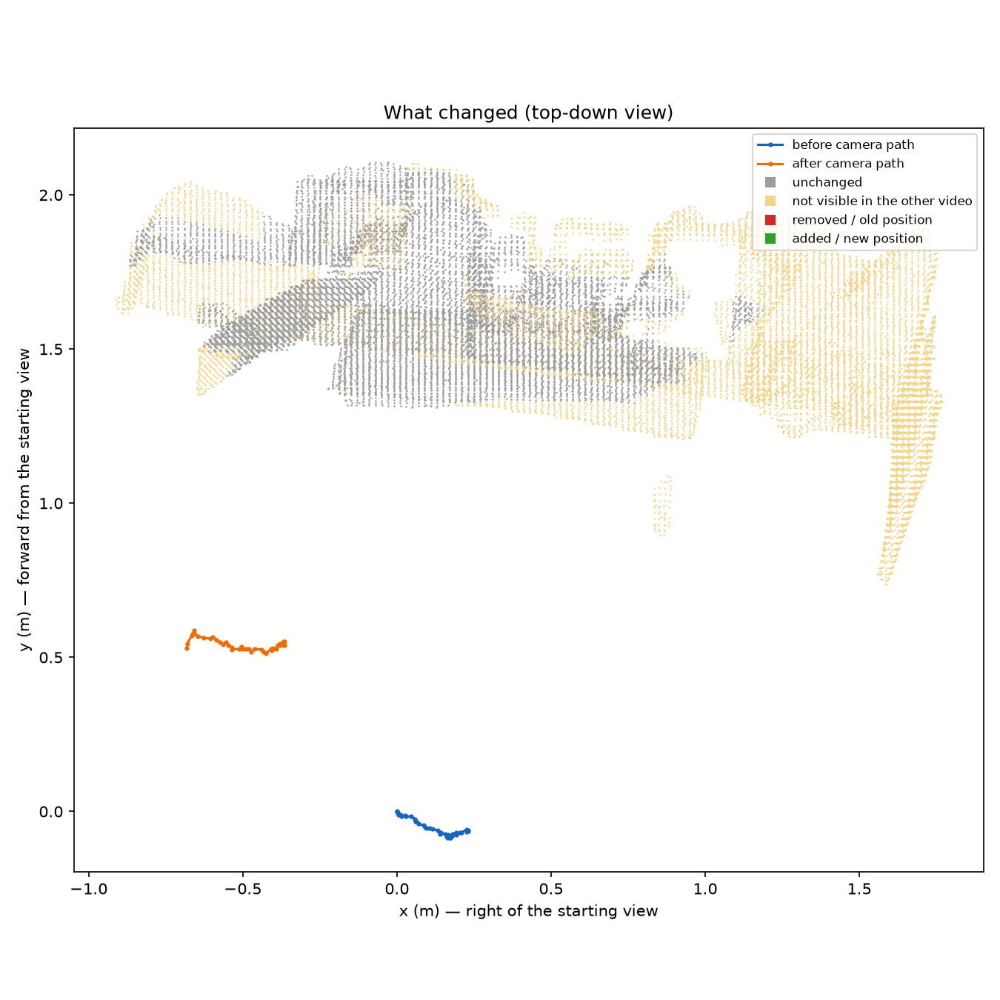

# What changed in the room

No changes found in the areas both videos could see.

**Not checked:** 11% of the surfaces seen in the after video and 59% of those in the before video were not visible (or not clear enough) in the other video. Changes there are not reported.

Video: [comparison.mp4](comparison.mp4) — reference and test side by side with every change marked.

Scale: metric_depth (factor 1.837). Alignment refinement: True.
