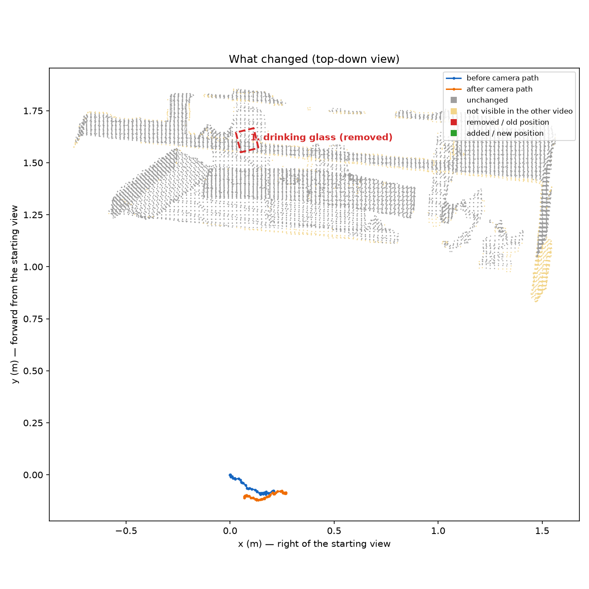

# What changed in the room

1. **Removed:** Drinking glass was removed. It was on the table surface, 1.6 m straight ahead of where the first video starts. (confidence 1.00)

**Not checked:** 4% of the surfaces seen in the after video and 11% of those in the before video were not visible (or not clear enough) in the other video. Changes there are not reported.

Video: [comparison.mp4](comparison.mp4) — reference and test side by side with every change marked.

Scale: metric_depth (factor 1.639). Alignment refinement: False.
